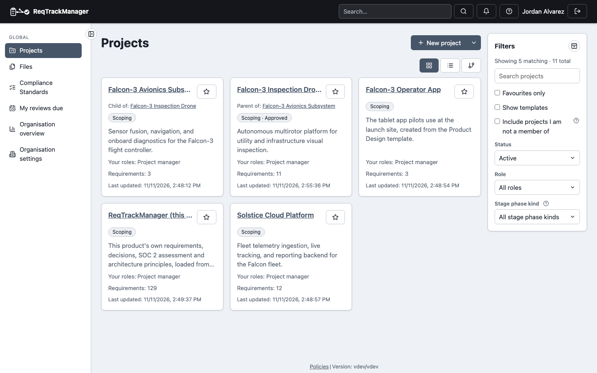
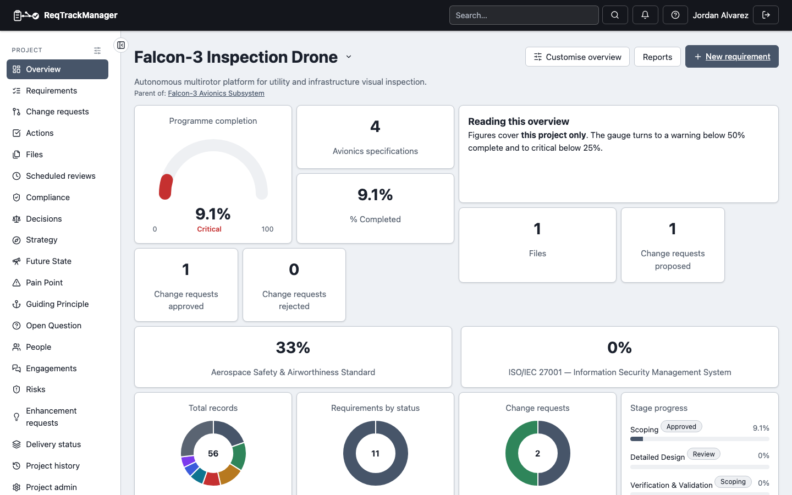

# Organisations and projects

## Finding your organisations

Click **Organisation settings** at the foot of the nav's Global section (or reach the same admin page from **Preferences → Your access**, which additionally lists your role at each one) to see every organisation you belong to, with a **Manage organisation** link wherever you hold `org_admin`. If you belong to only one organisation, this skips straight to it rather than showing a one-item list to choose from. See [Administering an organisation](./administering-an-organisation.md) for what happens once you're there.

## Organisation overview

**Organisation overview** in the nav (visible to any member, not just admins) is a dashboard for one organisation, built from the same widgets as a project's own Overview page, one level up. The built-in **Overview** page shows the project, requirement and member counts and the total file storage used, and enabled modules add their own widgets (Compliance adds a summary and an attention card). Figures count only what you can open; an organisation administrator sees the organisation's totals.

Organisation administrators choose **Customise** to place, resize, add and remove widgets with the same editor as a project, and the **Manage dashboards** icon beside the title adds further pages, renames, reorders and deletes them. A page can be limited to chosen people or organisation groups; anyone else does not see it in the menu, and its address returns them to the Overview. Organisation administrators always see every page. Like the organisations list above, it resolves straight to your one organisation if that's all you belong to. The **Organisation files** icon beside the title opens a list of the files of every project you can open (see [Organisation files](../core-features/file-attachments-and-shared-resources.md#organisation-files)). The **Organisation settings** icon beside the title opens [Organisation administration](./administering-an-organisation.md); the settings sections there are available according to your role.

## Browsing and finding projects

Open **Projects** in the nav. The list is filterable by active/archived status, by your role on the project, by the project's current stage status, and — if you belong to more than one organisation — by which organisation it's in, and is searchable by name or summary. Each card shows the project's organisation and how many requirements it currently has.

| Projects list |
| --- |
| Filterable, searchable project list with role and organisation filters |
|  |

Disabled organisations' projects are hidden by default; use the **All** filter to include them.

## Creating a project

Click **New project** from the Projects page — either blank, or **from a template** (any project in the organisation marked "usable as a project template," see [Core Features → Project templates](../core-features/project-templates.md)). Only an org admin or a project creator can do this; a plain member sees no create option. A [hierarchical project](../concepts/organisations-and-projects.md) can also be created as a sub-project of one you manage, from that parent project's own admin page.

Every project has a short **code** (for example `ACME`) that qualifies its record codes. Most organisations assign it automatically from the project's name, so the form has no code field; if your organisation lets the creator choose, the form asks for one and states the rule (length and allowed characters). The code can be edited later in the project's admin **Overview** only under that manual setting. See [Administering an organisation → Project codes](./administering-an-organisation.md#project-codes).

A project can also have a **Project report name**: a short name (up to 255 characters, like the project name) some reports print in headers, footers and titles when it is set, so a long project name does not have to fit. It is set when the project is created or in the project's admin **Overview**, and left blank it changes nothing. Only a report that writes `{{project_report_name}}` uses it, and that placeholder prints the project's name when none is set; every screen, list and link keeps the project's name, and a child project does not take its parent's. See [Custom reports → Designing a layout](../core-features/custom-reports/designing-a-layout.md#the-project-report-name).

A new project copies the organisation's current module and sub-component defaults (for every module the organisation has available). A project created from a template takes the template's own module switches instead, within what the organisation allows (see [Core Features → Project templates](../core-features/project-templates.md#what-a-template-carries-over)). Changing an organisation default later doesn't affect it; turning a module **Off** at organisation level does. See [Modules → Overview → Gating](../modules/overview.md#gating-entitlement--enablement--overrides) and [Administering a project → Modules](./administering-a-project.md#modules).

## Favouriting a project

Click the star icon next to a project to favourite it — favourited projects always sort to the top of your list, regardless of any other filter or search applied. Once you have at least one, a **Favourites** link appears in the nav's Global section as a quick jump list. **My reviews due** appears there only while a requirement review is due for you.

## Opening a project

Click into a project to reach its **Overview** — a summary of its stage, a **Total records** chart (every record in the project, split by type across the enabled modules; click a type to open its list), requirement status and change request counts, and recent activity, and the jumping-off point for every other project page (Requirements, Change Requests, Actions, Files, Reports, Project history, Project admin). A project manager can rearrange it into the widgets the team needs; see [Project overview](../core-features/project-overview.md).

| Project overview |
| --- |
| A project's overview: total records by type, requirement status, and recent activity |
|  |

## Where this fits

See [Organisations and projects](../concepts/organisations-and-projects.md) for the containment model and project hierarchy this page's filters and cards reflect, and [Roles, groups, and access control](../concepts/roles-groups-and-access-control.md) for why being an org admin alone doesn't grant you access to a project's requirements — you still need a project role, which is where [Administering a project](./administering-a-project.md) picks up.
