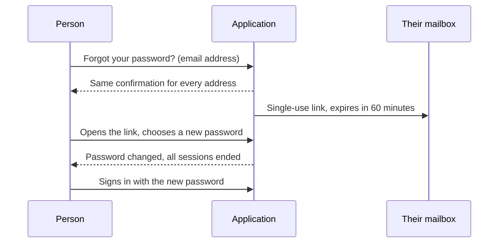

# Password resets and credential recovery

Passwords are reset with a **single-use link emailed to the account's own address**. Nobody, administrators included, ever sees another person's password or the link. The same mechanism covers a forgotten password, an administrator helping someone who is locked out, and the aftermath of a security incident or a [disaster-recovery restore](../installation-deployment/storage-database-and-migrations.md).

| Who | What they can do | Where |
| --- | --- | --- |
| Anyone with a password account | Ask for a link themselves | Sign-in page → **Forgot your password?** |
| Organisation admin | Email a link to a member of their organisation | **Org Admin → Users →** the person's **⋮** menu → **Send password reset link** |
| Server admin | Email a link to anyone; require one person to choose a new password; force a reset for everyone, one organisation or the server administrators | **Server Management → Access review** |
| Operator with shell access | Do all of the above with no application sign-in and no email | [Command line](#command-line-when-nobody-can-sign-in) |

Accounts that sign in through single sign-on have no password here, so there is nothing to reset: the person's identity provider owns it. Asking for a link for such an account sends nothing, and an administrator trying to send one is told why.

## How a reset works



- **One answer for every address.** The confirmation reads the same whether or not the address has an account, so the form cannot be used to find out who has one.
- **Single use, short life.** The link works once and expires after 60 minutes (`CREDENTIAL_RESET_TOKEN_MINUTES`). Using any link spends every other link the account has. Only a hash of the secret is stored.
- **The secret stays out of logs.** It is in the part of the address after `#`, which browsers never send to a server, and the page removes it from the address bar as soon as it has read it.
- **Not a sign-in.** Choosing a new password ends every session the account had and does not sign the person in. If they use two-factor authentication they are still asked for their code at the next sign-in; a reset never removes it.
- **Throttled.** Requests are rate-limited per client address, and an account that was sent a link in the last minute is not sent another.
- **Recorded.** Each request, send and completed reset is in the audit trail with who did it (never the link).

## Sending a link to someone else

Use this when a person is locked out and cannot ask for themselves, or you want to nudge them to a new password.

1. Open the person's **⋮** menu in **Org Admin → Users** (or **Server Management → Access review**) and choose **Send password reset link**.
2. Confirm. The link goes to the person's own address; you see only a confirmation, so you cannot use it to take over the account.
3. Nothing about their account changes until they use the link. Their current password keeps working until then.

An organisation admin can only do this for members of their own organisation. If email is not working (**Server Management → Email** has a test button), the action reports that rather than pretending to send.

## Forcing a reset

Use this after an incident: a stolen or exposed database or backup, a compromised host, or a restore of an old set. It is a server admin action and takes effect immediately.

**Server Management → Access review → Force a credential reset…** (or **Require new password** on one person's **⋮** menu):

| Choice | Effect |
| --- | --- |
| **Who** | Everyone (including you), one organisation's members, or the server administrators |
| **Also clear two-factor enrolment** | Removes authenticator enrolment so each person enrols again. Tick it when a leaked database might be paired with a leaked encryption key |
| **Email each person a new reset link** | Sends each person with a password a fresh link. Leave it off to hand links over yourself from the command line |

For everyone in scope this ends all sessions, revokes their [personal access tokens](../core-features/personal-access-tokens.md), spends any link sent before, and blocks password sign-in until they choose a new password. Someone who enters their *correct* old password is told their password must be reset and is pointed at **Forgot your password?**. Single-sign-on accounts have their sessions ended too, and sign in again with their identity provider as normal. Because the action is wide and immediate, you confirm by typing the word it asks for.

Forcing a reset does not rotate organisation SCIM tokens or the server's own secrets (`JWT_SECRET`, `APP_SECRET_ENCRYPTION_KEY`); rotate those separately if they may be exposed. See [Encryption and secrets handling](../enterprise-security/encryption-and-secrets-handling.md).

## Command line: when nobody can sign in

If every administrator is locked out, or email is down, run the tool inside the backend container. Its authority is shell and database access to the deployment, so it needs no application sign-in and works with the application stopped. Only `DATABASE_URL` is needed.

```bash
# let the first administrators back in: one single-use link per line, "email<TAB>link", printed to your terminal only
docker compose exec backend python -m app.cli.credentials issue-link --server-admins

# require a new password from everyone, clear two-factor enrolment, and email each person a link
docker compose exec backend python -m app.cli.credentials force-reset --all --reset-2fa --send --yes

# the same for one organisation (its code or id) or one person
docker compose exec backend python -m app.cli.credentials force-reset --org ACME --yes
docker compose exec backend python -m app.cli.credentials issue-link --user admin@example.com --ttl-minutes 120
```

- `force-reset` shows what it would do and changes nothing until you add `--yes`.
- Links go to standard output; counts and warnings go to standard error. People with no local password (single sign-on, invited) are listed in the output so they are never skipped silently. Treat the output as confidential: a link is a bearer secret until it is used or expires (up to 24 hours with `--ttl-minutes`).
- Every use is recorded in the audit trail as `cli:<your operating-system user>`, with counts and scope but never a link.

After a restore, `./scripts/restore.sh … --force-reset` applies the same reset to the restored copy before it goes live. See [Disaster recovery](https://github.com/ballardr/reqtrackmanager/blob/main/docs/disaster-recovery.md).

## Troubleshooting

| Symptom | Cause and fix |
| --- | --- |
| The email never arrives | Check the spam folder, then **Server Management → Email**. With `EMAIL_DELIVERY=disabled` no mail is ever sent; use the command line to hand a link over |
| "This reset link is invalid or has expired" | Used, expired, or superseded by a later link or a forced reset. Request a new one |
| "Your password must be reset before you can sign in" | A forced reset is pending for the account. Use **Forgot your password?** |
| An administrator is told the account has no password to reset | The account signs in with single sign-on, or every organisation it belongs to requires it |
| "A reset link was sent to this person less than a minute ago" | Wait a minute; the earlier link still works |
