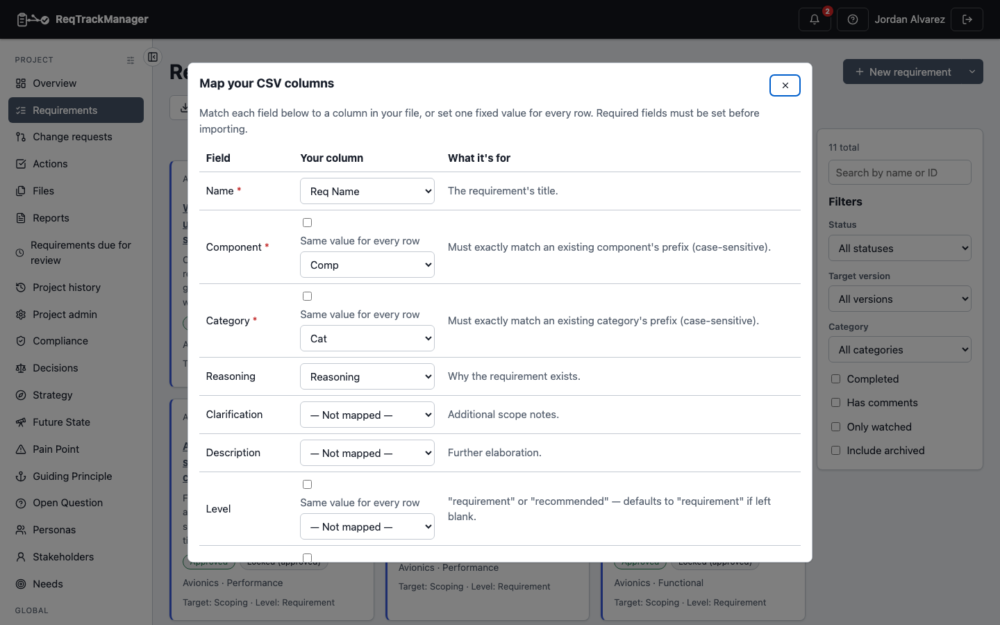

# Reporting and CSV import/export

## Generating a PDF, Word or CSV report

Open a project's **Reports** page:

1. Filter by component, category, status, or keyword to scope what's included.
2. Optionally pick one of the organisation's **report templates** for a PDF or Word export — an accent colour, cover page, and footer, for consistent on-brand output.
3. Generate the report with **Generate PDF**, or choose **More formats** for an editable Word file or CSV — a PDF or Word file includes the introduction, chapters and appendices written for that report type (**Project Admin → Report Setup**), falling back to the parent project's and then the organisation's defaults field by field wherever the project leaves one blank. See [Report content](../core-features/reports-and-export.md#report-content).

| Reports page |
| --- |
| Filtered PDF/Word/CSV export with a selectable organisation branding template |
|  |

## Exporting requirements to CSV

Two doors lead to the same data. The Reports page exports requirements as a formatted CSV. The **Requirements** page's own **Export** button downloads the list *as it is filtered on screen* as a CSV that you can edit and import back: every field, including custom field values and target stage, with the record's code in the first column. Columns that your organisation's policy keeps out of exports (personal data) are left out, and the Export menu says so.

The list's **Export** menu also offers **Download PDF report** and **Download Word report**: the same rows and filters as a formatted document. The Reports page's **Record list** report produces the same table for any record type without opening its list.

## Importing requirements from a CSV file

From a project's **Requirements** page, click **Import** and choose a file:

1. A **mapping** screen lists every field the import can set (Name, Component and Category are required for a new requirement; Reasoning, Description, Level, Target version, Owner, Reviewer, Tags, review fields and custom fields are optional) alongside a dropdown to pick which column in your file supplies it. For Component, Category, Level and Target version you can instead choose **Same value for every row**. A field you leave unmapped is left alone.
2. A row with a **Code** (`SW-PERF-014`) updates that requirement; a row without one creates a new requirement. Component and Category must match an existing prefix exactly (case-sensitive).

| CSV column mapping |
| --- |
| Mapping a CSV file's columns onto requirement fields |
|  |

3. Click **Preview**. Nothing is written yet: the preview shows how many requirements would be created, updated or left unchanged, the before and after of every changed field, and any row that has an error.
4. Click **Apply**. Valid rows are applied and a message reads "N created, N updated, N failed". Rows that failed (an unrecognised component prefix, say) are listed, and **Download error file** gives you just those rows to fix and import again.

An import goes through the same rules as editing by hand, so an approved requirement still has to change through a change request, and a requirement's status is never set from a file. **Export → Download import template** gives a CSV with the right column names for the project.

## Actions and change requests

The **Actions** and **Change requests** lists have the same **Export** menu, and it downloads the list as filtered on screen (the change request list's default "Active" view exports the active requests; pick **All statuses** to export them all).

- **Actions** also have **Import**, in the same file format: a row with a code updates that action (title, description, outcome, due date), a row without one creates it. An action's type is required for a new action and must match an existing action type by name.
- **Change requests** are export-only. The file carries each request's kind, status, target requirement, reason, the values it proposes, who created and decided it, and its dates. There is no import: a change request is a proposal whose content depends on its kind, and it is submitted and approved in the application, so it is written in its form.

## Strategy, Pain Points, People and the rest of the module lists

The lists of the Context & Strategy and Stakeholders & Personas modules have the same **Export** and **Import**: Strategy, Future State, Guiding Principle, Pain Point, Open Question, Persona, Stakeholder, Stakeholder Group, Stakeholder Need and Engagement. A list that shows several kinds at once (the **People** list) offers one pair per kind, named for it (**Export personas**, **Export stakeholders**); pick one kind with the kind chips to export it with that kind's own filters. Research findings have no list of their own; export them from the **Reports** page's **Record list** report.

Each file follows the page's filters (status, priority, type, search, "Open only", archived, tags, a Stakeholder group, an engagement's participant or date range, the nested-project scope), and an import is a preview first, then an apply, exactly as for requirements.

- **A file never moves a record through its lifecycle.** Status is in the file for reference and is ignored on import; a new record starts as the form starts it (a Strategy as a draft, a Pain Point as submitted, an Open Question as open). A Strategy, Future State or Guiding Principle past review, and a Pain Point or Open Question that reached a terminal outcome, refuse an edit with the same message the form gives.
- **Who may import.** Anyone who may create the record in the form may create it from a file, and the owner role (Strategy Owner, Pain Point Manager, Persona Owner and so on) may change one. A Pain Point or Open Question owner is assigned by a manager, so a file that names an owner on a new row needs that role.
- **Personal data.** A Stakeholder's name, role and group, contact details and availability, the free text about a named person, and an Engagement's summary and notes are personal data. They are left out of every export, and ignored on import, until your organisation allows each kind (**Organisation Admin → Security**) and you hold the permission to export personal data. The Export menu says when columns were left out.
- **Organisation records in a project's list.** A Persona, Stakeholder or Stakeholder Group the organisation shares with every project is exported with its organisation-qualified code (`ACME-PER-001`) and is not changed by an import into a project. To change the organisation's own records from a file, use the organisation overview (next section).
- **Links stay on the record.** An Engagement's participants, covered personas and audience groups, a group's members and parent, and a Pain Point's scores are managed on the record, not in the file. A research finding names its engagement by code when it is created and cannot be moved to another.

## The organisation's own records

The organisation overview lists the records the organisation owns itself, and each list has the same **Export** (CSV, PDF, Word) and **Import** beside its **New** button: **Strategies**, **Future States**, **Guiding Principles**, **Personas**, **Stakeholders** and **Stakeholder Groups**. The file holds only the organisation's own records, filtered as the panel is, with codes qualified by the organisation code (`ACME-STR-001`; the bare `STR-001` is also accepted on import). A code that belongs to a project's record, or to another organisation, is reported as an unknown code and nothing changes.

Who may import follows the panel: any member may create a Strategy, Future State or Guiding Principle, the matching owner role may change one, and creating or changing a Persona, Stakeholder or Stakeholder Group needs that type's owner role. Personal data is governed by the same organisation policy as in a project, but the permission to export it is the organisation-level one (organisation administrators by default).

## Risks, Decisions and Compliance

The **Risk** register, the **Decisions** list and Compliance **Evidence** have the same **Export** and **Import**, following the list's filters and previewing before they apply.

- **Risks.** The six scoring levels are written by the level's name on its axis in your organisation's scheme (`Likely`, `Major`); the inherent and residual ratings are in the file for reference and recalculated from the levels. A file never changes a risk's status, and an accepted risk's assessment cannot be edited by a file any more than in the form. Creating a risk is open to any project member; changing one needs the Risk Manager role.
- **Decisions.** The type is a name of the project's decision types (a child project may use its parent's). A new row is a draft owned by whoever imports it; an approved or superseded decision refuses an edit. Changing one needs the Decision Owner role.
- **Evidence.** The expiry date can be given when evidence is created from a file; afterwards it changes only by revalidating the evidence, which keeps the previous date. Creating or changing evidence needs the Compliance Officer role.
- **Read-only compliance lists.** A project's compliance assessments, its required-action assessments (including the outstanding ones on the **Outstanding** tab) and a standard version's requirements export but have no import: assessments move through the justification and approval workflow, and a standard's requirements are authored in a draft version's tree. These records have no code of their own, so the **Code** column holds the requirement's clause reference and the standard, version and requirement columns identify the row.

## Where this fits

See [Core Features → Reports and export](../core-features/reports-and-export.md) for report-content editing (Markdown/WYSIWYG, image inserts, organisation defaults), and [Authoring and reviewing requirements](./authoring-and-reviewing-requirements.md) for creating requirements one at a time instead of in bulk.
