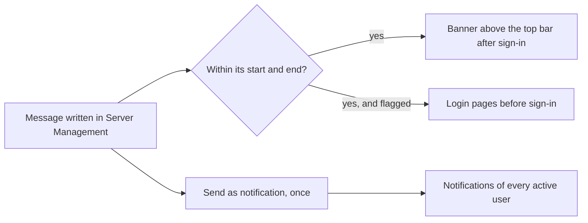

# Server administration

Server administration is a narrow, cross-tenant management role — a server admin can see every organisation on the deployment for oversight and support, without that visibility becoming a way to read or act on any specific org's or project's actual content. Reaching this role at all requires being granted `is_server_admin`, separate from any organisation or project role.

## Seeing every organisation

**Server Management → Organisations** lists every organisation on the deployment — creation date, active/disabled status — regardless of whether the server admin belongs to any of them.

| Server: organisations |
| --- |
| Every organisation on the deployment, visible to a server admin regardless of membership |
|  |

Opening any one org's admin page from here as a server admin (rather than an org member) reveals nothing about its actual content — users, groups, and resources all refuse access, so the org's requirements and change requests stay off-limits even to this role.

## Server Management

**Server Management** groups deployment-wide settings and platform-level user directory tools:

| Server management |
| --- |
| Access review, platform branding, public sign-up, email, messages, module, report font and data policy settings |
|  |

- **Access review** — the platform-wide user directory: every user on the deployment, filterable to orphaned accounts (no organisation membership at all) or other server administrators. **Add user** creates a person from here (see [Adding a user](#adding-a-user)).
- **Password help** — each person's **⋮** menu offers **Send password reset link** (emailed to them, never shown to you) and **Require new password**; **Force a credential reset…** covers everyone, one organisation or the server administrators after an incident. See [Password resets and credential recovery](./password-reset-and-credential-recovery.md), including the command-line tool for when no administrator can sign in.
- **Platform branding** — the deployment's own logo and login-page styling, distinct from an organisation's own branding.
- **Public sign-up** — the deployment-wide sign-up mode: disabled (accounts created by an admin or invite only), always on (anyone can create an account, joining no organisation automatically), or restricted to organisations that have opted in by email domain. See [Signing in → Signing up](./signing-in.md#signing-up) for what a user sees on the other side of this setting.
- **Email** — deployment-wide outbound email configuration.
- **Messages** — platform-wide announcements (see [below](#messages)).
- **Data policy** — the deployment default for personal data in record exports and imports (see [below](#personal-data-in-exports-and-imports)).
- **Modules** — which [modules](../modules/overview.md) exist for whom: the default entitlement policy (open or closed), what an organisation gets for a module it has not chosen itself (available, and on for new projects), an **Apply to all organisations** action that writes those defaults into existing organisations (type the word shown to confirm), and a per-organisation list to grant or withdraw a module. A module withdrawn from an organisation disappears from its administrators' and projects' module lists. A fresh install starts with every module available; an upgraded one changes only when you choose.
- **Report fonts** — the fonts report authors can choose. The four bundled fonts are always offered. A house typeface is added by putting its `.ttf` files in the font directory the deployment mounts (see [Extra report fonts](../installation-deployment/production-deployment.md#extra-report-fonts)) and pressing **Rescan**. For each provided family you can switch **Offered to authors** off (layouts already using it keep working), set the **Name in Word and OpenDocument** and a **Generic fallback** (sans-serif, serif or monospace) for readers who lack the font. The page lists the faces found with each font's licence permission, and every file that was skipped with the reason (for example, a font whose licence forbids embedding). You are responsible for the licence of every font you provide. PDF reports always carry the real font; Word and OpenDocument files name it.

## Messages

**Server Management → Messages** holds announcements for everyone on the deployment: a planned outage, a release, or a hint on a demonstration instance. Each message has a **title**, a plain-text **message**, a **severity** (Information, Warning or Critical) and a **Show from** and **Show until** time, entered in your local time. A new message starts now and has no end, so it shows at once until it is deleted; set an end to schedule its removal. A scheduled message shows its status as Scheduled, Active or Ended.

- **Show on the login pages** also shows the message on the platform login page and on every organisation's branded login page, before anyone signs in. Anyone who can open those pages can read it, so keep it free of anything confidential.
- A message is plain text: it is shown exactly as typed, with no links or formatting. The banner stays above the top bar while the page scrolls. Severity is shown by the message's colour, an icon and its name, not by a badge.
- **Can be dismissed** (checked by default) lets people close the message in their own browser; a dismissed message returns if their browser data is cleared. Clear it for a notice that must stay visible until it ends, such as a degraded-performance warning: the banner then has no close control. It stays a banner above the page and never blocks it.
- The list has two views: **Current** (active and scheduled) and **Previous** (ended), with a search over the title and text. **Duplicate** on any row opens a new message with the same content, starting now, with no end and no notification sent. Ended messages do not count toward the limit of 50 current messages.
- **Send as notification** sends the message once to every active user. Each person's [notification preferences](./notifications.md#choosing-how-youre-notified) apply, and you are not notified of your own send. The row then records how many people it reached, and it cannot be sent again. An ended message cannot be sent.
- Organisation administrators write messages for their own organisation only; they cannot see or change yours.

## Personal data in exports and imports

**Server Management → Data policy** sets the deployment-wide default for whether record columns that hold personal data (names and identifiers, contact details, free text that can quote people) may leave the application in an export, or be written by an import. Everything is excluded until you allow it, so a fresh install lets no personal data out through a file. Allowing a kind asks for confirmation; excluding one does not. An organisation can set its own rule under **Security** in its [admin page](./administering-an-organisation.md#personal-data-in-exports-and-imports), and one that has not follows this default. Each change is recorded in the audit log with the old and new value.

## Adding a user

**Server Management → Access Review → Add user ▾** creates an account without going through an organisation first. The button opens a menu of two ways to add a person, each with its own dialog:

| Menu item | What happens | Organisation |
|--------|--------------|--------------|
| **New user** (a password you set) | The account exists at once and the person can sign in. You know the password until they change it, so share it securely. At least 8 characters. | Optional. With none, the account belongs to no organisation until an admin adds it (it then shows as an orphaned account). With one, pick the role. |
| **Invite user** | The person gets an email link and chooses their own name and password. This works even when public sign-up is off. | Optional. With one they join it as a member (change their role after they sign up); with none they get an account with no organisation. |

An SSO-only organisation can't be chosen (its people sign in through the identity provider), and an email that already has an account is refused. Every creation is recorded in the audit log under your name. This dialog cannot make someone a server admin; use **Assign server roles** on their row for that.

## Managing orphaned accounts

An **orphaned account** — a user with no organisation membership at all — is the one category of user a server admin can act on directly: deactivate/reactivate, or ban. A banned account can't be granted a fresh organisation role even via a direct API call.

## Incident response: revoking every Personal Access Token

**Server Management** also offers a platform-wide **Revoke all Personal Access Tokens** action — an incident-response tool that revokes every non-revoked token in the deployment regardless of who owns it or which organisation(s) it's scoped to. Use it only for an actual credential-compromise incident, not routine token management (revoke an individual token from [Preferences → Personal Access Tokens](../core-features/personal-access-tokens.md) instead).

## Where this fits

See [Roles, groups, and access control](../concepts/roles-groups-and-access-control.md) for how server-admin scope compares to organisation and project roles, and [Administering an organisation](./administering-an-organisation.md) for what an org admin (a narrower, single-tenant role) can do instead.
