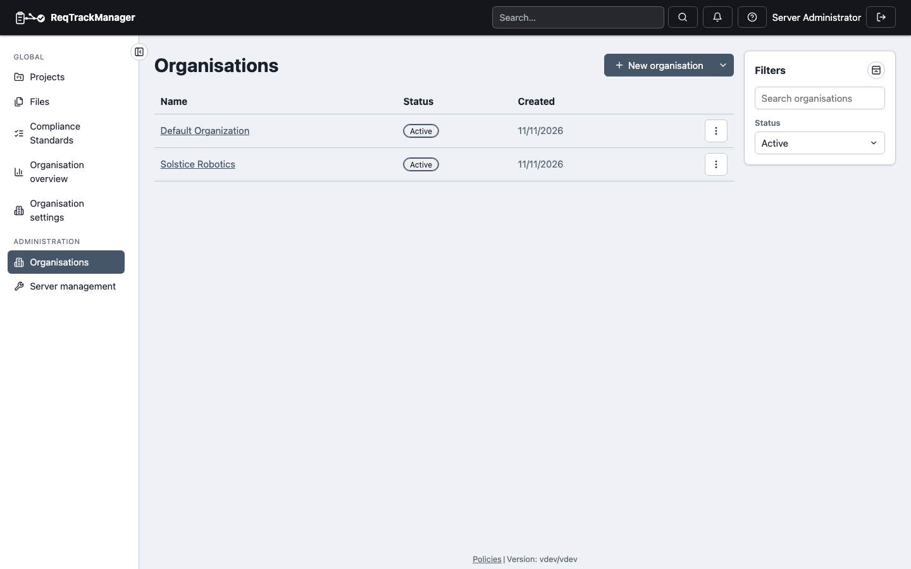
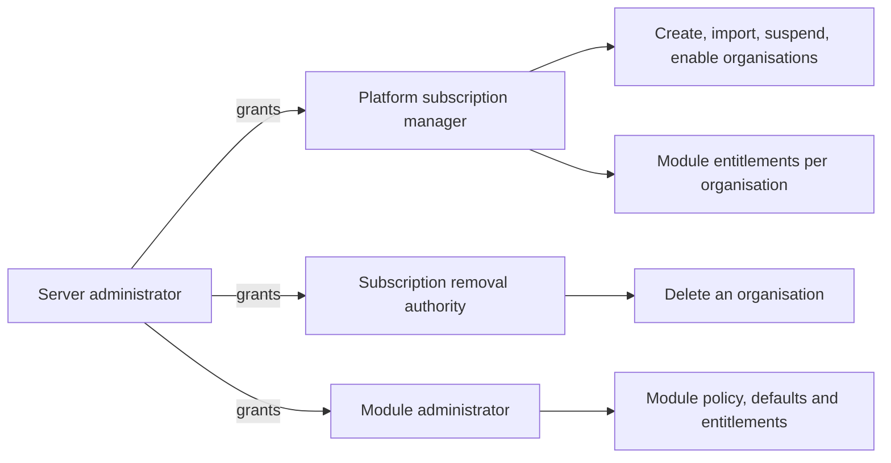
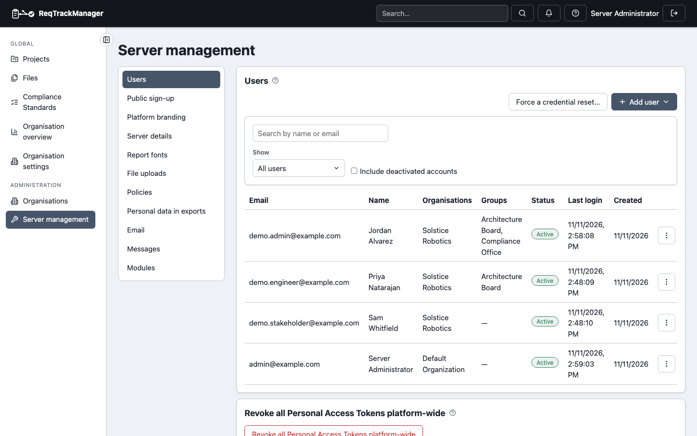
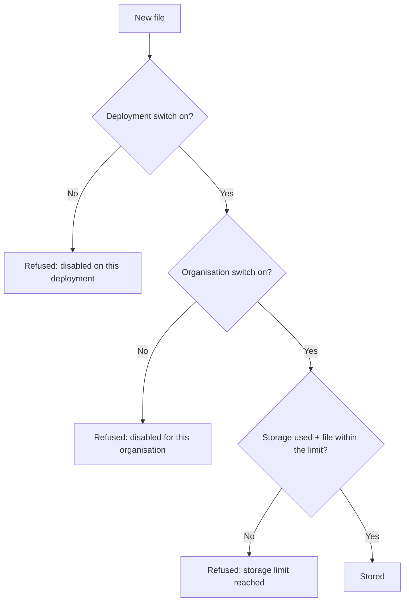
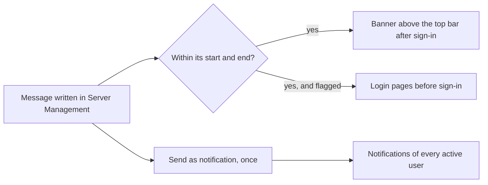
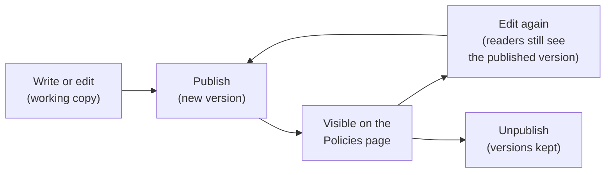

# Server administration

Server administration is a narrow, cross-tenant management role — a server admin can see every organisation on the deployment for oversight and support, without that visibility becoming a way to read or act on any specific org's or project's actual content. Reaching this role at all requires being granted `is_server_admin`, separate from any organisation or project role.

## Seeing every organisation

**Server Management → Organisations** lists every organisation on the deployment — creation date, active/disabled status — regardless of whether the server admin belongs to any of them. Click a column heading to sort, and use the search and **Status** filter beside the list; a server administrator opens an organisation's administration from its name or the **Administration** row action. A Platform subscription manager or Subscription removal authority sees the same list (see [Server roles](#server-roles)); the row actions each person sees depend on their role.

| Server: organisations |
| --- |
| Every organisation on the deployment, visible to a server admin regardless of membership |
|  |

Opening any one org's admin page from here as a server admin (rather than an org member) reveals nothing about its actual content — users, groups, and resources all refuse access, so the org's requirements and change requests stay off-limits even to this role.

## Server roles

Besides the full server administrator, a server administrator can grant narrower **server roles** from **Users → ⋮ → Assign server roles**. A role is checked on every request, so revoking it takes effect at once. A holder cannot grant a role to anyone, and a personal access token never carries one.

| Role | Can | Cannot |
| --- | --- | --- |
| **Platform subscription manager** | Create, import, suspend and enable an organisation; see the organisation list; set an organisation's module entitlements | Delete an organisation; join one as its administrator; change any other server setting; read any organisation's records |
| **Subscription removal authority** | See the organisation list; permanently delete an organisation and all of its data after typing its name | Create, suspend or change an organisation; read any organisation's records |
| **Module administrator** | Set the module entitlement policy, the module defaults and each organisation's entitlements | Create or delete an organisation |

The two subscription roles are independent: holding one does not give the other, so provisioning and deletion can be held by different people. They read only the organisation directory (names, state and counts), never the records an organisation holds. Each person sees only the sections their role allows: the navigation shows **Organisations** to either subscription role and **Server management** to a server administrator, a Module administrator or a Platform subscription manager (**Modules** only). Every action is recorded in the audit log under the person's name and the role used.

## Server Management

**Server Management** groups deployment-wide settings and platform-level user directory tools:

| Server management |
| --- |
| Users, public sign-up, platform branding, server details, report fonts, file uploads, policies, personal data in exports, email, messages and modules |
|  |

The groups are listed in the order above, related ones together. Each group of fields has one **Save**, which is unavailable until something changes; a picture or a single switch acts at once. A person sees only the groups their server role allows, and one with no server role is told that Server management is not available to them.

- **Users** — the platform-wide user directory: every user on the deployment, filterable to orphaned accounts (no organisation membership at all) or other server administrators, with a **Status** column (Active, Deactivated or Banned). **Add user** creates a person from here (see [Adding a user](#adding-a-user)). **Revoke all Personal Access Tokens platform-wide**, an incident-response action, is on the same page and needs the word shown to be typed before it runs.
- **Password help** — each person's **⋮** menu offers **Send password reset link** (emailed to them, never shown to you) and **Require new password**; **Force a credential reset…** covers everyone, one organisation or the server administrators after an incident. See [Password resets and credential recovery](./password-reset-and-credential-recovery.md), including the command-line tool for when no administrator can sign in.
- **Platform branding** — the header title, the accent colour, the **Logo band colour** (the band behind the logo, described next), the login page background and the word used for an organisation throughout the interface (**Terminology**). An organisation that has not set its own value shows these.
- **Logo band colour** — a logo that is white on a transparent background is invisible on a light page, so the logo sits on a coloured band. On **Platform branding**, **Logo band colour** sets that band for the sign-in pages, for the header of outgoing email and for reports. A preview shows the band with the current logo, and a warning appears while the colour is light (it never blocks saving: a dark logo suits a light band). The platform or organisation name is drawn on the same band, under the logo, so the two read as one; **Logo band text colour** sets its colour (empty is black or white, whichever reads better on the band, and a second warning appears when the chosen colour is hard to read). **Remove** beside either colour returns to its default, the colour of the application's top bar for the band. An organisation that sets no colour of its own shows the platform colour. Reports are unchanged until a colour is chosen, so an existing dark logo on white paper keeps its appearance.
- **Server details** — the deployment's logo and the **Footer details**: an optional **Prefix** shown before the company name (for example "Hosted by" or "Managed by", so a person using the service for another organisation does not take the operator for their own company), the company name (which links to the website), the postal address and a company identifier (a label such as ABN and the number). They are printed in the footer of every page and of outgoing email. In email, an organisation that has set its own company name shows its own details instead, without the prefix or identifier; an organisation that has not shows these. The logo and the login page background belong to the deployment, not to any organisation, and each has a **Remove** button that returns to the built-in picture.
- **Public sign-up** — the deployment-wide sign-up mode: disabled (accounts created by an admin or invite only), always on (anyone can create an account, joining no organisation automatically), or restricted to organisations that have opted in by email domain. See [Signing in → Signing up](./signing-in.md#signing-up) for what a user sees on the other side of this setting.
- **File uploads** — one switch, **Allow file uploads**, that is on by default, and a **Default storage limit** (in MB or GB) for organisations that have no limit of their own; leave it empty for no limit. Only a server administrator changes either. When it is off, no new file is accepted anywhere on the deployment: record and comment attachments, evidence, profile pictures, logos and login backgrounds, shared resources and report pictures. Existing files stay readable and can still be deleted. Every upload control stays visible but unavailable, and a tooltip says that uploads are disabled on this deployment. Reports run in the background still store their output, so reporting keeps working. See [Importing when uploads are disabled](../core-features/zip-export-import.md#importing-when-uploads-are-disabled). An organisation's own switch and limit are set per organisation (see [Organisation storage](#organisation-storage)).
- **Email** — send a test message to confirm that outgoing email works.
- **Messages** — platform-wide announcements (see [below](#messages)).
- **Policies** — the privacy policy, the data policy and any other policy the deployment publishes (see [below](#policies)).
- **Personal data in exports** — the deployment default for personal data in record exports and imports (see [below](#personal-data-in-exports-and-imports)).
- **Modules** — which [modules](../modules/overview.md) exist for whom: the default entitlement policy (open or closed), what an organisation gets for a module it has not chosen itself (available, and on for new projects), an **Apply to all organisations** action that writes those defaults into existing organisations (type the word shown to confirm), and a per-organisation list to grant or withdraw a module. A module withdrawn from an organisation disappears from its administrators' and projects' module lists. A fresh install starts with every module available; an upgraded one changes only when you choose.
- **Report fonts** — the fonts report authors can choose. The four bundled fonts are always offered. A house typeface is added by putting its `.ttf` files in the font directory the deployment mounts (see [Extra report fonts](../installation-deployment/production-deployment.md#extra-report-fonts)) and pressing **Rescan**. For each provided family you can switch **Offered to authors** off (layouts already using it keep working), set the **Name in Word and OpenDocument** and a **Generic fallback** (sans-serif, serif or monospace) for readers who lack the font. The page lists the faces found with each font's licence permission, and every file that was skipped with the reason (for example, a font whose licence forbids embedding). You are responsible for the licence of every font you provide. PDF reports always carry the real font; Word and OpenDocument files name it.

## Organisation storage

A server administrator or a **Platform subscription manager** can stop new files for one organisation, or cap how much storage it uses, from **Organisations → ⋮ → Storage**. An organisation's administrators see the limit and their usage but cannot change them.

| Setting | Effect |
| --- | --- |
| **Allow file uploads** | Off stops every new file for that organisation. Other organisations are unaffected. |
| **Storage limit** | The most the organisation may use, in MB or GB, counting its files and the stored outputs of its background reports. Empty follows the **Default storage limit**; a limit of 0 accepts no new file. |

Lowering a limit below current use only stops new files: nothing is deleted, files stay readable and can be deleted, and deleting frees space for the next upload. When an organisation reaches 90% of its limit, its administrators receive one notification and the usage table shows a warning; the notice is sent again only after usage has fallen below 90% and risen back. Importing a bundle whose files do not fit the space left offers **Cancel import** or **Import without files**. These settings belong to the platform operator and are not part of an organisation export.

## Messages

**Server Management → Messages** holds announcements for everyone on the deployment: a planned outage, a release, or a hint on a demonstration instance. Each message has a **title**, a plain-text **message**, a **severity** (Information, Warning or Critical) and a **Show from** and **Show until** time, entered in your local time. A new message starts now and has no end, so it shows at once until it is deleted; set an end to schedule its removal. A scheduled message shows its status as Scheduled, Active or Ended.

- **Show on the login pages** also shows the message on the platform login page and on every organisation's branded login page, before anyone signs in. Anyone who can open those pages can read it, so keep it free of anything confidential.
- A message is plain text: it is shown exactly as typed, with no links or formatting. The banner stays above the top bar while the page scrolls. Severity is shown by the message's colour, an icon and its name, not by a badge.
- **Can be dismissed** (checked by default) lets people close the message in their own browser; a dismissed message returns if their browser data is cleared. Clear it for a notice that must stay visible until it ends, such as a degraded-performance warning: the banner then has no close control. It stays a banner above the page and never blocks it.
- The list has two views: **Current** (active and scheduled) and **Previous** (ended), with a search over the title and text. **Duplicate** on any row opens a new message with the same content, starting now, with no end and no notification sent. Ended messages do not count toward the limit of 50 current messages.
- **Send as notification** sends the message once to every active user. Each person's [notification preferences](./notifications.md#choosing-how-youre-notified) apply, and you are not notified of your own send. The row then records how many people it reached, and it cannot be sent again. An ended message cannot be sent.
- Organisation administrators write messages for their own organisation only; they cannot see or change yours.

## Policies

**Server Management → Policies** is where the deployment publishes its written policies. The **Privacy policy** and the **Data policy** are always listed first (marked **Not written** until you write them) and keep their titles; **New policy** adds any other, such as an acceptable use policy.

- The text is written in a visual editor: headings, paragraphs, bulleted and numbered lists, quotations, a horizontal rule, bold, italic and links (https, http or mailto addresses only). Anything outside that set cannot be saved.
- **Save** stores the working copy only. People keep reading the published version until you press **Publish**, which records a new version with its date and an optional **Change note** that only administrators see. A policy with edits not yet published shows **Unpublished changes**.
- **Effective from** is a calendar date shown with the policy; it does not delay publication.
- **Version history** lists every published version. **Unpublish** removes a policy from the Policies page and keeps its versions; it can be published again. A policy that is not built in can also be deleted, with its versions.
- Everything published is readable by anyone, without signing in, at `/policies`. A **Policies** link appears below the sign-in form and at the foot of the navigation rail while at least one policy is published. Drafts and unpublished policies are never shown, and while nothing is published the link is absent and `/policies` redirects to the sign-in page (or the project list when signed in).
- Publishing and unpublishing are recorded in the audit log with the policy's key and version, never its text.
- **Require acceptance** makes every person with an account accept the current version of the policy. Until they do, they can read and sign out but cannot create or change records. The **Acceptance** action lists who has and has not accepted, exports the list and sends reminders; it works as described in [Administering an organisation](./administering-an-organisation.md#requiring-acceptance). An organisation administrator cannot require acceptance of a server policy.

## Personal data in exports and imports

**Server Management → Personal data in exports** sets the deployment-wide default for whether record columns that hold personal data (names and identifiers, contact details, free text that can quote people) may leave the application in an export, or be written by an import. Everything is excluded until you allow it, so a fresh install lets no personal data out through a file. Allowing a kind asks for confirmation; excluding one does not. An organisation can set its own rule under **Security** in its [admin page](./administering-an-organisation.md#personal-data-in-exports-and-imports), and one that has not follows this default. Each change is recorded in the audit log with the old and new value.

## Adding a user

**Server Management → Access Review → Add user ▾** creates an account without going through an organisation first. The button opens a menu of two ways to add a person, each with its own dialog:

| Menu item | What happens | Organisation |
|--------|--------------|--------------|
| **New user** (a password you set) | The account exists at once and the person can sign in. You know the password until they change it, so share it securely. At least 8 characters. | Optional. With none, the account belongs to no organisation until an admin adds it (it then shows as an orphaned account). With one, pick the role. |
| **Invite user** | The person gets an email link and chooses their own name and password. This works even when public sign-up is off. | Optional. With one they join it as a member (change their role after they sign up); with none they get an account with no organisation. |

An SSO-only organisation can't be chosen (its people sign in through the identity provider), and an email that already has an account is refused. Every creation is recorded in the audit log under your name. This dialog cannot make someone a server admin; use **Assign server roles** on their row for that.

## Managing orphaned accounts

An **orphaned account** — a user with no organisation membership at all — is the one category of user a server admin can act on directly: deactivate/reactivate, or ban. A banned account can't be granted a fresh organisation role even via a direct API call.

## Incident response: revoking every Personal Access Token

**Server Management** also offers a platform-wide **Revoke all Personal Access Tokens** action — an incident-response tool that revokes every non-revoked token in the deployment regardless of who owns it or which organisation(s) it's scoped to. Use it only for an actual credential-compromise incident, not routine token management (revoke an individual token from [Preferences → Personal Access Tokens](../core-features/personal-access-tokens.md) instead).

## Where this fits

See [Roles, groups, and access control](../concepts/roles-groups-and-access-control.md) for how server-admin scope compares to organisation and project roles, and [Administering an organisation](./administering-an-organisation.md) for what an org admin (a narrower, single-tenant role) can do instead.
