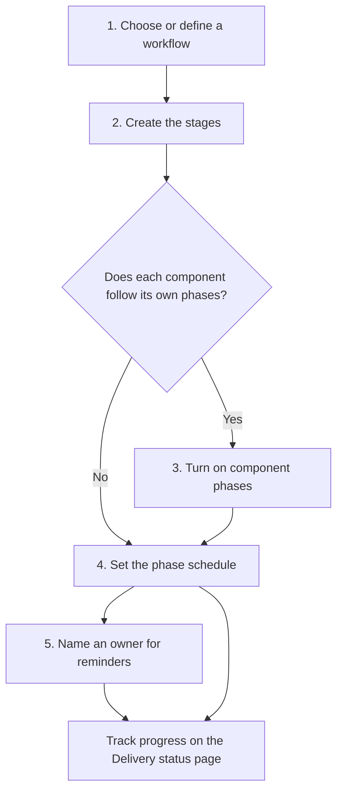

# Setting up stages and phases

Stages, workflows, component phases and the phase schedule are four settings under **Project Admin → Workflows and phases**. Each depends on the one before it, so configure them in this order. Steps 3 to 5 are optional; a project that skips them has one phase for the whole stage.

## 1. Choose or define a workflow

Open **Stage workflows**. The organisation's workflows are listed with the project's own; **Standard** (Scoping, Review, Approved, Completed, Archived) is always available. Select **New workflow** to add a workflow of the project's own, or hide an organisation workflow the project does not use. Give each phase a name and a kind (Open, Review, Locked, On hold or Closed); the kind decides what entering the phase does. See [Stages and baselining](../core-features/stages-and-baselining.md#workflows-and-phases).

## 2. Create the stages

Open **Project stages**, enter a name, choose the workflow the stage follows and select **New stage**. The stage starts in the workflow's first phase. A stage can change workflow only while it is in an Open phase and has no baseline, so choose before work begins.

## 3. Turn on component phases (optional)

Open **Component phases** and set the project to **On** (or **Follow the parent project**). Every component then has a track for each stage. For each track you can:

- choose another workflow;
- mark the stage **Not applicable** to the component;
- name an owner (a user or a group), who can then move the track without project administration access.

Leave the setting **Off** when one phase for the whole stage is enough; turning it off later keeps the tracks but ignores them.

## 4. Set the phase schedule (optional)

Open **Stage schedule**. Enter the expected start and expected end of each phase, for the stage or, with component phases on, for a component's track. These dates feed the Overdue badge on the Delivery status page and the upcoming and overdue reminders. See [Phase schedule and reminders](../core-features/stages-and-baselining.md#phase-schedule-and-reminders).

## 5. Name an owner (optional)

In **Stage schedule**, choose the stage's owner (a user or a group). Reminders go to that owner, or for a track to the track's owner first. With no owner they go to the project managers. A person can switch each reminder type off under **Preferences**.

## After set-up

Project members follow progress on the **Delivery status** page, and the people who own a track move it through its phases there. See [Delivery status](../core-features/stages-and-baselining.md#delivery-status) and [Stages, baselining, and reviews](./stages-baselining-and-reviews.md) for moving a stage through review and approval.
