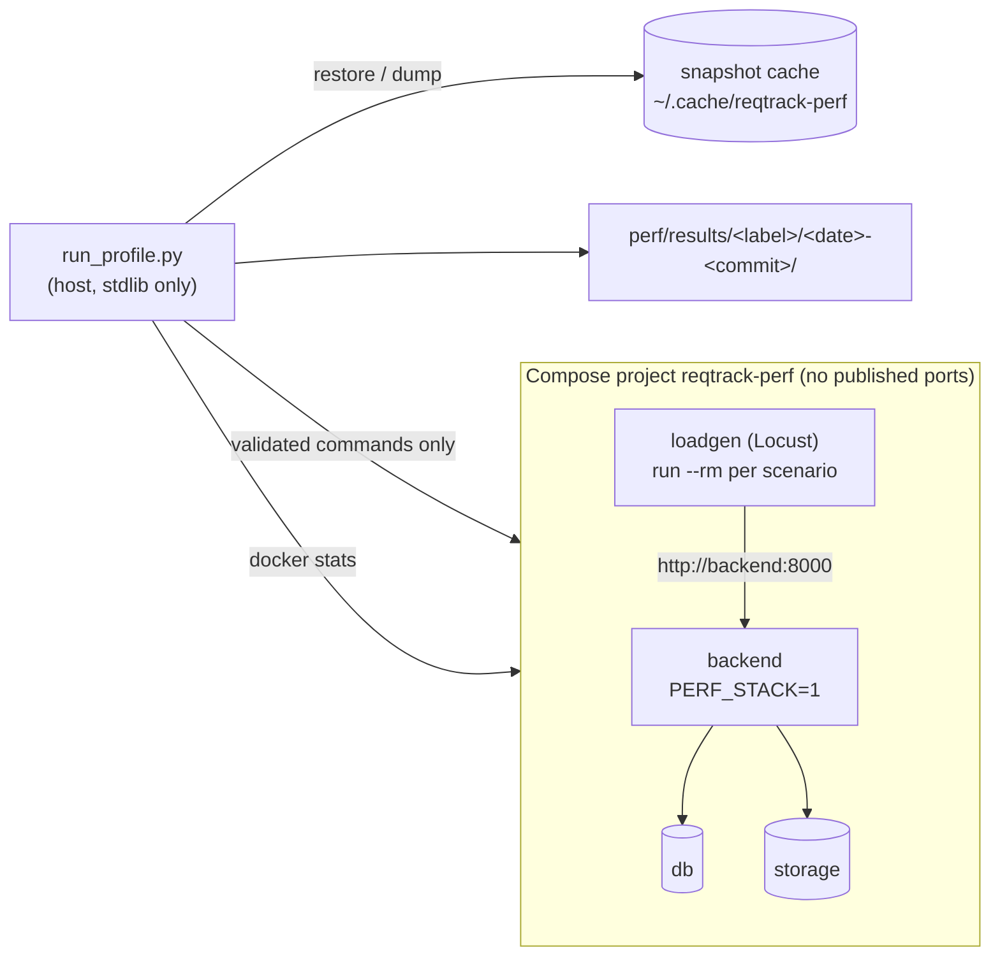
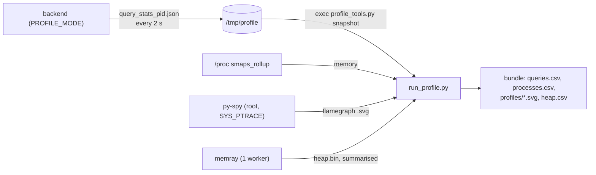

# Performance profiling (`perf/`)

Measures how the backend, database and object store behave as data grows, on any host with Docker: a Mac running
Docker Desktop, a Linux VM, a Raspberry Pi. One command per host writes an anonymised results bundle; hosts are
compared relatively.

```sh
perf/run_profile.sh <host-label> --plan          # read what it will create and what it will not touch
perf/run_profile.sh mac-docker-desktop --quick   # T0 + T1, one repeat, minutes
perf/run_profile.sh rpi5-8g --full --dedicated   # all tiers, repeats, soak (overnight on a Pi)
perf/run_profile.sh <host-label> --cleanup       # remove leftovers of a crashed run
perf/run_profile.sh <host-label> --quick --tiers T1 --profiling cpu    # + a py-spy flamegraph per scenario
perf/run_profile.sh <host-label> --quick --tiers T1 --profiling heap   # one worker under memray: what it holds
python3 perf/analyse.py perf/results/<label>/<date>-<commit>
```

Needs Docker with Compose 2.24 or newer, Python 3.9 or newer and git. Nothing else, so it runs on a bare Pi.
Host labels are generic (`rpi5-8g`), never a name you gave the machine.

## How a run works



1. Preflight: Docker and Compose versions, no foreign `reqtrack-perf*` resource, headroom (load, memory, swap,
   disk), then caps are chosen.
2. For each tier: an empty database, then the tier's snapshot is restored, or generated by
   `generate_dataset.py` (structure through the API, records by bulk insert) and snapshotted for next time.
3. This run's passwords are set (`prepare_run.py`), then each scenario runs at each user level and repeat while
   container memory and CPU are sampled with `docker stats`.
4. The bundle is written, checked for anything identifying, archived; the stack is torn down in every case.

## Backend workers

`--workers auto` (the default) picks the most the CPU and memory budget supports, at most 4 (the production default), at about 0.5 GiB per worker plus 0.5 GiB for the parent. A budget that cannot run one worker is refused. The chosen count and `workers_auto` are recorded in `run.json`; a full run with an automatic count carries a note, because the headline comparison between hosts needs the same count: name it (`--workers 2`) for runs you intend to compare.

## Profiling the backend (memory, CPU, statements per request)

Container metrics say *that* memory or CPU is high; these say *where*. Every run records the first two; the
profilers are opt-in because they slow the backend.

| Question | What answers it | Where it lands |
|----------|-----------------|----------------|
| How much does each worker cost, and how much of it is shared? | `scripts/profile_tools.py memory` reads `/proc/<pid>/smaps_rollup` after every scenario (private, shared, proportional) | `processes.csv`; `analyse.py` prints private and shared MiB per worker |
| Does a route run one statement per row (an N+1)? | Profile mode (`backend/app/profiling.py`) counts statements per request by route template; the runner diffs the totals per scenario | `queries.csv` (statements and database ms per request); `analyse.py` flags a count that grows with the data; the run prints the statement a request repeated most |
| Where is CPU going? | `--profiling cpu`: py-spy samples the backend's process tree during the highest-load run of each scenario | `profiles/cpu-<tier>-<scenario>-u<users>.svg` (source paths shortened) |
| What does a worker hold, by source line and package? | `--profiling heap`: one worker runs under memray (slow); after the run it is stopped and the capture summarised | `heap.csv` (by package and by line), `heap_live_mib` and `heap_peak_mib` in `run.json` |
| Is something leaking after warm-up? | `PROFILE_TRACEMALLOC=true`: lines whose allocations grew since a baseline taken after warm-up (or on `SIGUSR2`) | `tracemalloc_<pid>.json` in the profile output directory (manual use) |



- **No new surface.** Profile mode writes files in the container and adds no endpoint, metric or log line; it is off
  unless `PROFILE_MODE=true`, which only the perf override and `docker-compose.profile.yml` set. The output holds
  route templates, counts and parameterised statement text, never a bound value or a record.
- **The profile image** (`--target profile` of `backend/Dockerfile`: the API image plus memray and py-spy) is built
  only by the profiling modes or `docker-compose.profile.yml`, with its own image name, and is never published.
  py-spy needs `SYS_PTRACE`, granted to the perf backend container only (its own PID namespace).
- **Profiled latency is not comparable.** A profiling run says so in `run.json`; memory and statement counts are.
- **On the development stack** (not the isolated perf stack):
  `docker compose -f docker-compose.yml -f docker-compose.profile.yml up -d --build backend`, then
  `docker compose exec backend python scripts/profile_tools.py snapshot` (memory and statements) or
  `docker compose exec -u root backend py-spy record -p 1 --subprocesses -d 60 -o /profile/cpu.svg`. Set
  `PROFILE_MEMRAY=1` to start one worker under memray; `docker compose stop backend` finalises `/profile/heap.bin`
  (`memray flamegraph --leaks`, or `profile_tools.py heap`).
- **Heap profiling covers one tier** (one backend start). Allocations made while a module is imported are
  attributed to the first frame outside the import machinery, so a library loaded by a module is counted under the
  importing code when the library allocates from C.

## Dataset tiers

Requirements per project; every tier also scales the other record types and the links between them
(`datasets/profiles.yaml`, a recorded input of every run, not a code constant).

| Tier | Requirements | Purpose |
|------|--------------|---------|
| T0 | 30 | Smoke and regression baseline (sized like the e2e seed set) |
| T1 | 100 | Typical small project |
| T2 | 1,000 | Large project; per-row costs first show |
| T3 | 5,000 | Very large; where O(n²) and memory spikes show |
| T4 | 20,000 | Stress ceiling (a host that cannot finish T4 records that) |

`--breadth` varies shape instead: `projects-10/50/200` (many projects per organisation, the priority), `orgs-5/25`,
`nested-3x5`. `--density sparse|typical|dense` sets the mean links per requirement (1, 3, 8) with a heavy tail: a
few hub requirements hold hundreds. Link density is a stated synthetic assumption; no populated instance was used.

## Scenarios

`browse`, `list_unpaged`, `list_filtered`, `search`, `links`, `edit` (quick mode); `export_csv`, `import_preview`,
`report_pdf`, `report_docx`, `bundle_export`, `bundle_import`, `attachment`, `project_scope`, `soak` (full mode;
heavy ones are opt-in on a shared host with `--allow-heavy`). Login is done once per simulated person before the
clock starts, so the numbers measure the API, not bcrypt. `scenarios` are defined in `loadgen/scenarios.py` and
listed with their parameters in `lib/catalog.py`.

## Safe to run on a production host

The stack is isolated by construction; the hardware is shared, so its impact is bounded, not eliminated.

| Risk | Control |
|------|---------|
| Touching production data or containers | Own Compose project `reqtrack-perf` with its own database, storage, volumes and network. No option names a database, API, project, file or port. Every Docker command goes through `lib/compose.py`, which refuses prune, `--rmi`, and any `rm`/`stop`/`volume rm`/`network rm` naming a resource outside `reqtrack-perf-*`. Docker runs with a scrubbed environment, so an exported `POSTGRES_PASSWORD` or `COMPOSE_FILE` cannot leak in or redirect it. |
| Name or port collisions | No published ports at all, no fixed container names, perf-only image names (a local build never retags a production image). A run refuses to start if anything shares the `reqtrack-perf` prefix without the project label, or if the project already exists. |
| Credentials | Generated per run into a 0700 temp directory, removed at the end; never read from the environment or a `.env`. |
| Notifications | `EMAIL_DELIVERY=disabled` and a placeholder SMTP host: 20,000 generated records cannot email anyone. |
| CPU and memory | Hard caps with no swap (default: half the cores and a quarter of Docker's memory, half on Docker Desktop; `--max-cpus`, `--max-mem`), reduced CPU shares, so an OOM kills the perf container. |
| Disk | Preflight estimates image, database and snapshot size and refuses without headroom. |
| A busy host | Preflight refuses on load, low memory or swap; a watchdog samples them during the run (and `--watch-url`, a GET-only health poll of production) and stops and tears down the stack when a threshold is crossed (`aborted` in `run.json`). |
| Leftovers | Teardown runs on success, failure, Ctrl-C and abort; `--cleanup` removes what a crash left, by the same scoped rule. |

Honest limits: isolation is by Docker project, not hypervisor. A Docker daemon or kernel problem (daemon restart,
out of file descriptors) can still affect production. The watchdog reduces that risk, it cannot remove it. For a
host with strict availability needs, run on a clone or a separate machine, run outside peak hours, and keep
`--allow-heavy` off. A single-board host that also serves production is usually too tight and the preflight will say
so. Results from a shared host are flagged `shared_host`: latency is not comparable with a dedicated host's, memory
per service still is.

## What is in a bundle (and what never is)

`host.json` (architecture, cores, RAM, Docker VM allocation, OS family, storage class, generic CPU family),
`run.json`, `dataset.json`, `samples.csv`, `latency.csv`, `queries.csv`, `processes.csv`, and for a profiling run
`heap.csv` and `profiles/*.svg`. Built from an allowlist; never recorded: hostname,
username, paths, serials, MAC or IP addresses, Docker or container ids, environment variables, git author or branch
names. A dirty tree or a commit not on a remote branch marks the run `non_publishable`.
`python3 perf/scrub_check.py` (also a repository test and part of the pre-commit hook) scans `perf/results/`;
the runner refuses to write an archive that fails it. The archive has owners zeroed and times normalised.

## Tests

Tests that pin behaviour (the command builder, anonymisation, the generator and its parity with the API) are in the
main backend suite and run in CI (`backend/tests/test_perf_runner.py`, `test_perf_dataset.py`). Timing, load and
memory numbers are never gated in CI: they are read, from a run.

## Not built yet (tracked)

- Dataset generators for the module record types (`ModuleDefinition.perf_generators`); the gap list in
  `test_perf_dataset.py` shrinks as they land. Attachments, and a frontend page-load scenario at T2 and T3 (a
  Playwright-driven browser run), are not part of the first runner.
- `pg_stat_statements` arrives with the PostgreSQL profiling work; `pgstat.csv` is written empty until then.
- Statements run while a streamed response body is produced (some exports) are not counted in `queries.csv`.
- `compare.py` (run-to-run diff) and the plotting script come with the baseline-recording and website work.

## Re-measure when

A new module or record type; a change to a list, report, export or search path; a migration touching a large
table; a Python, PostgreSQL or uvicorn major bump; a change to the worker model or pool settings; before a
release that changes any of these.
