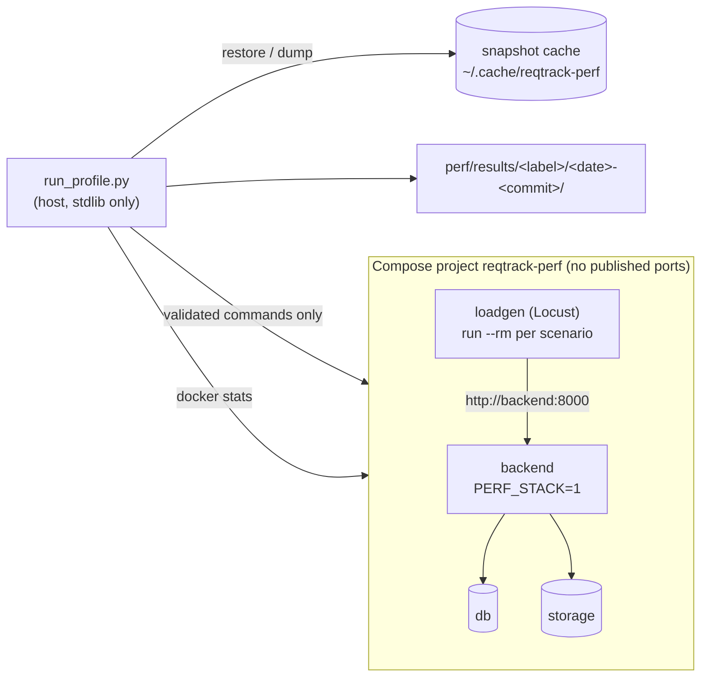
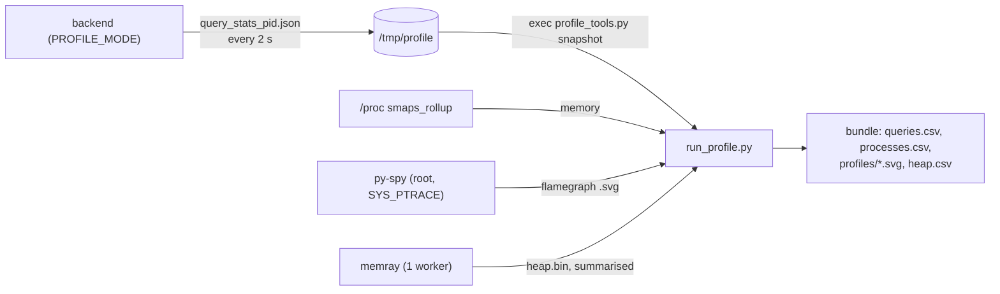
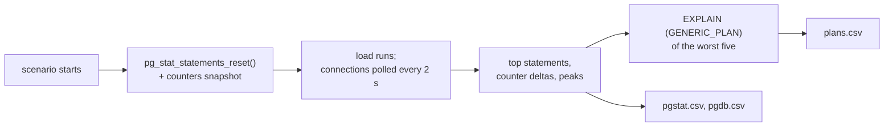

# Performance profiling (`perf/`)

Measures how the backend, database and object store behave as data grows, on any host with Docker: a Mac running
Docker Desktop, a Linux VM, a Raspberry Pi. One command per host writes an anonymised results bundle; hosts are
compared relatively.

```sh
perf/run_profile.sh <host-label> --plan          # read what it will create and what it will not touch
perf/run_profile.sh mac-docker-desktop --quick   # T0 + T1, one repeat, minutes
perf/run_profile.sh rpi5-8g --full --dedicated   # all tiers, repeats, soak (overnight on a Pi)
perf/run_profile.sh <host-label> --cleanup       # remove leftovers of a crashed run
perf/run_profile.sh <host-label> --quick --tiers T1 --profiling cpu    # + a py-spy flamegraph per scenario
perf/run_profile.sh <host-label> --quick --tiers T1 --profiling heap   # one worker under memray: what it holds
python3 perf/analyse.py perf/results/<label>/<date>-<commit>
```

Needs Docker with Compose 2.24 or newer, Python 3.9 or newer and git. Nothing else, so it runs on a bare Pi.
Host labels are generic (`rpi5-8g`), never a name you gave the machine.

## How a run works



1. Preflight: Docker and Compose versions, no foreign `reqtrack-perf*` resource, headroom (load, memory, swap,
   disk), then caps are chosen.
2. For each tier: an empty database, then the tier's snapshot is restored, or generated by
   `generate_dataset.py` (structure through the API, records by bulk insert) and snapshotted for next time.
3. This run's passwords are set (`prepare_run.py`), then each scenario runs at each user level and repeat while
   container memory and CPU are sampled with `docker stats`.
4. The bundle is written, checked for anything identifying, archived; the stack is torn down in every case.

## Backend workers

`--workers auto` (the default) picks the most the CPU and memory budget supports, at most 4 (the production default), at about 0.5 GiB per worker plus 0.5 GiB for the parent. A budget that cannot run one worker is refused. The chosen count and `workers_auto` are recorded in `run.json`; a full run with an automatic count carries a note, because the headline comparison between hosts needs the same count: name it (`--workers 2`) for runs you intend to compare.


`--db-pool-size` and `--db-max-overflow` set each worker's database pool (the application defaults are 5 and 10). More workers
need a smaller pool: `workers x (pool + overflow + 2)` must stay under the 97 connections PostgreSQL allows clients, and the
runner refuses a combination that does not fit and suggests one that does (eight workers: `--db-pool-size 3 --db-max-overflow 7`).
A worker admits as many concurrent requests as its pool holds, so a smaller pool also lowers each worker's request limit.

## Profiling the backend (memory, CPU, statements per request)

Container metrics say *that* memory or CPU is high; these say *where*. Every run records the first two; the
profilers are opt-in because they slow the backend.

| Question | What answers it | Where it lands |
|----------|-----------------|----------------|
| How much does each worker cost, and how much of it is shared? | `scripts/profile_tools.py memory` reads `/proc/<pid>/smaps_rollup` after every scenario (private, shared, proportional) | `processes.csv`; `analyse.py` prints private and shared MiB per worker |
| Does a route run one statement per row (an N+1)? | Profile mode (`backend/app/profiling.py`) counts statements per request by route template; the runner diffs the totals per scenario | `queries.csv` (statements and database ms per request); `analyse.py` flags a count that grows with the data; the run prints the statement a request repeated most |
| Where is CPU going? | `--profiling cpu`: py-spy samples the backend's process tree during the highest-load run of each scenario | `profiles/cpu-<tier>-<scenario>-u<users>.svg` (source paths shortened) |
| What does a worker hold, by source line and package? | `--profiling heap`: one worker runs under memray (slow); after the run it is stopped and the capture summarised | `heap.csv` (by package and by line), `heap_live_mib` and `heap_peak_mib` in `run.json` |
| Is something leaking after warm-up? | `PROFILE_TRACEMALLOC=true`: lines whose allocations grew since a baseline taken after warm-up (or on `SIGUSR2`) | `tracemalloc_<pid>.json` in the profile output directory (manual use) |



- **No new surface.** Profile mode writes files in the container and adds no endpoint, metric or log line; it is off
  unless `PROFILE_MODE=true`, which only the perf override and `docker-compose.profile.yml` set. The output holds
  route templates, counts and parameterised statement text, never a bound value or a record.
- **The profile image** (`--target profile` of `backend/Dockerfile`: the API image plus memray and py-spy) is built
  only by the profiling modes or `docker-compose.profile.yml`, with its own image name, and is never published.
  py-spy needs `SYS_PTRACE`, granted to the perf backend container only (its own PID namespace).
- **Profiled latency is not comparable.** A profiling run says so in `run.json`; memory and statement counts are.
- **On the development stack** (not the isolated perf stack):
  `docker compose -f docker-compose.yml -f docker-compose.profile.yml up -d --build backend`, then
  `docker compose exec backend python scripts/profile_tools.py snapshot` (memory and statements) or
  `docker compose exec -u root backend py-spy record -p 1 --subprocesses -d 60 -o /profile/cpu.svg`. Set
  `PROFILE_MEMRAY=1` to start one worker under memray; `docker compose stop backend` finalises `/profile/heap.bin`
  (`memray flamegraph --leaks`, or `profile_tools.py heap`).
- **Heap profiling covers one tier** (one backend start). Allocations made while a module is imported are
  attributed to the first frame outside the import machinery, so a library loaded by a module is counted under the
  importing code when the library allocates from C.

## Profiling the database (always on)

The perf stack's PostgreSQL loads `pg_stat_statements` (the perf override only; never the production or
development compose files). For every scenario the runner resets it, polls client connections while the load runs,
and afterwards keeps what the database did.

| Question | What answers it | Where it lands |
|----------|-----------------|----------------|
| Which statements cost the most? | `pg_stat_statements`, top 15 by total time per scenario: calls, total and mean ms, rows, blocks read, temp blocks. DML only, literals already replaced by `$n`, `::type` casts dropped | `pgstat.csv` |
| How many connections does the backend really hold, and is the cache big enough? | `pg_stat_activity` counts every 2 s (peak, idle-in-transaction peak, no query text); `pg_stat_database` deltas: buffer cache hit rate, temp files and MiB spilled, deadlocks | `pgdb.csv` |
| Does the pool fit `max_connections`? | The backend's pool settings and `workers x (pool + overflow + 2)` against the server's `max_connections` | `run.json` (`db_pool`, `postgres`); `analyse.py` flags a ceiling above the usable connections |
| Are `shared_buffers` and `work_mem` adequate? | Hit rate below 99 % names `shared_buffers`; any temp file names `work_mem`. Defaults are only changed on this evidence | `pgdb.csv`, `run.json` (`postgres`: the five relevant settings) |
| Which scans does the planner choose for the worst statements? | `EXPLAIN (GENERIC_PLAN, FORMAT JSON)` of the five costliest statements per scenario: scan type, table, index, estimated rows (filter text is not kept); a filtered `Seq Scan` over 1,000+ estimated rows is flagged as a possible missing index | `plans.csv` |



- **Analyse before planning.** After the dataset is loaded the runner runs `ANALYZE`, standing in for the autovacuum a
  real database would get within a minute; without it the planner's estimates describe an empty database.
- **Plans are estimates.** `GENERIC_PLAN` needs no parameter values and executes nothing, so it is safe and its output
  holds no literal, but it shows the planner's choice, not actual time (that is in `pgstat.csv`). For an
  `EXPLAIN (ANALYZE, BUFFERS)` of a flagged statement, run it by hand with real parameters against the kept stack
  (`--keep`, then `docker compose -p reqtrack-perf ... exec db psql`); do not commit the output.
- **Same on every run.** The extension is always loaded, so its small overhead is in every number and runs stay
  comparable. It is never loaded outside the perf stack. A database that cannot load it leaves the three files empty
  and says so in `run.json`'s notes.
- **No new surface and no identifying text.** Only DML is kept (a utility statement such as `SET` or `CREATE ROLE`
  keeps its literals in `pg_stat_statements`), `pg_stat_activity` is read for counts only, and the anonymisation
  check still gates the bundle.
- **Pool settings.** `DB_POOL_SIZE` (default 5) and `DB_MAX_OVERFLOW` (default 10) bound each worker's connections;
  with two dedicated ones (the `LISTEN` listener and the leadership lock) a worker holds at most 17, so the default
  four workers hold at most 68 of PostgreSQL's 97 usable connections. Raise workers or replicas and the sum must stay
  below `max_connections` (default 100, 3 reserved).

## Run recipes

Commands for the runs this project's findings and sizing are based on. Run each inside `tmux new -s perf` (detach with
Ctrl-b then d, reattach with `tmux attach -t perf`) so a dropped SSH session does not end it. Results land under
`perf/results/<label>/`; copy the archive each run prints (`~/.cache/reqtrack-perf/<date>-<commit>.tar.gz`) to wherever
you collect them. Run from a pushed commit: a dirty tree or an unpushed commit marks the bundle non-publishable. If the
commit shows as empty in the bundle's name, git cannot read the repository as the user running the script (root):
`git config --global --add safe.directory <path to the repository>`.

```sh
# Read what a run will create and what it will not touch (any host)
perf/run_profile.sh <label> --plan

# Quick check that the runner works on a host: T0 and T1, one repeat, minutes
perf/run_profile.sh <label> --quick

# A dedicated host (nothing else runs on it): every tier, three repeats, heavy scenarios and the soak
perf/run_profile.sh workstation-wsl2 --full --dedicated --workers 4

# A server that also serves production: browsing and writes at every tier, then the heavy scenarios in a quiet window.
# --watch-url stops the run if production's health check slows; the load limit is raised because the load average counts the
# run's own threads
perf/run_profile.sh linux-vm-4c8g --full --workers 4 --max-load-per-core 3 --watch-url $PROD_HEALTH_URL
perf/run_profile.sh linux-vm-4c8g --full --workers 4 --allow-heavy --max-load-per-core 3 --watch-url $PROD_HEALTH_URL

# After a change to large-project behaviour: the two largest tiers and the scenarios that exercise them
perf/run_profile.sh linux-vm-4c8g --full --tiers T3,T4 --scenarios edit,browse,list_filtered,bundle_import --workers 4 --allow-heavy --max-load-per-core 3 --watch-url $PROD_HEALTH_URL

# A Raspberry Pi 5 (8 GB, one worker, a 2.7 GiB budget; T3 and T4 do not fit unless nothing else is running)
perf/run_profile.sh rpi5-8g --full --workers 1 --max-mem 2.7 --tiers T0,T1,T2 --max-load-per-core 4 --storage nvme
```

### How throughput scales with workers

`capacity` steps simulated connections up at T2 (see above) and reports the usable level. Run it at 2, 4 and 6 workers on one
host with the same pool, so only the worker count varies: `workers x (pool + overflow + 2)` must stay under 97, and
4 + 10 gives 96 for six workers (`--workers-sweep` picks it for you). The backend gets about half the stack's CPU budget, so give the stack twice as many
CPUs as the largest worker count (`--max-cpus 12` for six).

```sh
perf/run_profile.sh workstation-wsl2 --full --tiers T2 --scenarios capacity --workers-sweep 2,4,6 --max-cpus 12 --dedicated
python3 perf/analyse.py --workers perf/results/workstation-wsl2/<date>-<commit> ...    # the sweep prints the exact line
```

`--workers-sweep 2,4,6` runs the profile once per worker count, one after another, each as its own run and bundle, and
stops at the first run that fails or aborts. It gives every run the same pool: the application's default if the largest count
fits PostgreSQL's connections with it, else the largest pool that does (six workers: 4 + 10); pass `--db-pool-size` and
`--db-max-overflow` to choose your own. The final `analyse.py --workers` table has one row per worker count: the usable
level, the requests per second delivered there, per worker, and the first level beyond the budget.

To find where a bigger stack saturates, raise the levels (`--capacity-users 256,384,512`); the default top level, 256 connections,
is below the knee for six workers on six cores:

```sh
perf/run_profile.sh linux-vm-4c8g --full --tiers T2 --scenarios capacity --workers 6 --db-pool-size 4 --db-max-overflow 10 --max-cpus 12 --capacity-users 256,384,512 --allow-heavy --max-load-per-core 3 --watch-url $PROD_HEALTH_URL
```

Every create takes its project's counter lock, so a capacity run whose writes all go to one project (the default `single`
shape) is limited by that project's create rate (about 14 per second) before the CPU. Spread the writes over ten projects to
measure the CPU-bound ceiling:

```sh
perf/run_profile.sh linux-vm-4c8g --full --tiers T2 --breadth projects-10 --scenarios capacity --workers 6 --db-pool-size 4 --db-max-overflow 10 --max-cpus 12 --capacity-users 256,384,512 --allow-heavy --max-load-per-core 3 --watch-url $PROD_HEALTH_URL
```

To see whether the ceiling depends on project size, run the same capacity climb at a larger tier (ten projects of 5,000
requirements is 50,000 in all, so the dataset takes a while to build the first time):

```sh
perf/run_profile.sh linux-vm-4c8g --full --tiers T3 --breadth projects-10 --scenarios capacity --capacity-tier T3 --workers 6 --db-pool-size 4 --db-max-overflow 10 --max-cpus 12 --capacity-users 256,384,512 --allow-heavy --max-load-per-core 3 --watch-url $PROD_HEALTH_URL
```

To test the database's memory settings on the same climb (the T3 database no longer fits PostgreSQL's default `shared_buffers`),
set them for the perf stack only; the runner refuses a buffer larger than half the database's memory cap, and `run.json`
records the settings that were in force:

```sh
perf/run_profile.sh linux-vm-4c8g --full --tiers T3 --breadth projects-10 --scenarios capacity --capacity-tier T3 --workers 6 --db-pool-size 4 --db-max-overflow 10 --max-cpus 12 --pg-shared-buffers 512MB --pg-work-mem 16MB --capacity-users 256,384 --allow-heavy --max-load-per-core 3 --watch-url $PROD_HEALTH_URL
```

Read the result as requests per second per worker: it should stay near 50 while the backend's CPU is the limit. A fall
means the database, the project row lock taken by every create, or the host's own cores became the limit (the run notes
the load generator's CPU, so a ceiling it caused is not read as the backend's). On a server shared with production use
`--allow-heavy`, `--max-load-per-core` and `--watch-url` instead of `--dedicated`, and keep the worker count within the
CPUs production can spare.

## Dataset tiers

Requirements per project; every tier also scales the other record types and the links between them
(`datasets/profiles.yaml`, a recorded input of every run, not a code constant). Every registered artefact type has a
generator (`ModuleDefinition.perf_generators`; a module registers its own, core never names a module's type): the
project-scoped types per requirement (`ratios.records`: change requests 0.3, risks 0.6, decisions 0.4, pain points 1.0,
needs 0.6, engagements 0.4, findings 0.6, and so on), and the four compliance types from a catalogue per organisation
(`compliance`: 5 standards of 60 requirements, 2 assigned to each project), so compliance follows the projects, not the
requirement count. Records link to earlier types with the density's mean degree and a heavy tail, 5% of a nested
project's links going to its parent and 2% to a sibling project (dormant: outside the ancestry, so the application
counts them unavailable and never shows them). The most-linked record of each type pair is planted with up to
`hub_max_degree` (1,000) links, so a T3 project has hubs of 1,000 links in every pair; the manifest reports links and
the largest hub per `source>target` pair (`link_pairs`) and each project's three most-linked records per type
(`type_hubs`). In a nested profile one member (`restricted_email`) holds no role on the deepest projects, so the graph
from a parent omits and counts what they cannot open. Change requests carry proposed links. A T2 project (1,000
requirements) holds about 75,000 rows and generates in about 15 seconds; a T3 project about 444,000 rows in about a
minute.

| Tier | Requirements | Purpose |
|------|--------------|---------|
| T0 | 30 | Smoke and regression baseline (sized like the e2e seed set) |
| T1 | 100 | Typical small project |
| T2 | 1,000 | Large project; per-row costs first show |
| T3 | 5,000 | Very large; where O(n²) and memory spikes show |
| T4 | 20,000 | Stress ceiling (a host that cannot finish T4 records that) |

`--breadth` varies shape instead: `projects-10/50/200` (many projects per organisation, the priority), `orgs-5/25`,
`nested-3x5`. `--density sparse|typical|dense` sets the mean links per requirement (1, 3, 8) with a heavy tail: a
few hub requirements hold hundreds. Link density is a stated synthetic assumption; no populated instance was used.

## Scenarios

`browse`, `list_unpaged`, `list_filtered`, `search`, `links`, `edit` (quick mode); `export_csv`, `import_preview`,
`report_pdf`, `report_docx`, `bundle_export`, `bundle_import`, `attachment`, `project_scope`, `soak` (full mode;
heavy ones are opt-in on a shared host with `--allow-heavy`). Login is done once per simulated person before the
clock starts, so the numbers measure the API, not bcrypt. `scenarios` are defined in `loadgen/scenarios.py` and
listed with their parameters in `lib/catalog.py`.

### Capacity: how many connections, and so how many people, one stack serves

`capacity` steps simulated connections up at one tier (T2, 1,000 requirements, unless `--capacity-tier` names another) until the stack saturates or fails, so the
result is a curve and a number, not a latency at a fixed load. Each connection makes about one API request a second
(browse plus roughly one request in five a write); a real person makes one every several seconds, so a level stands
for 5-10 times as many active people (`budgets.yaml` sets the interval, and `analyse.py` prints the estimate beside each level). It is a heavy scenario (`--allow-heavy` or `--dedicated`).

```sh
perf/run_profile.sh <label> --quick --tiers T2 --scenarios capacity --allow-heavy      # 16 and 64 connections
perf/run_profile.sh <label> --full --tiers T2 --scenarios capacity --allow-heavy       # 16, 32, 64, 128, 256
perf/run_profile.sh <label> --quick --tiers T2 --scenarios capacity --allow-heavy --capacity-users 8,32,96
```

- Each level is judged on the share of the offered rate delivered, the failure rate and the request-weighted p95
  (`budgets.yaml`, `capacity`); `analyse.py` prints each level and the largest usable one. The climb stops at the first
  level that delivers under half the offered rate or fails more than 5% of requests, and the backend is left to go
  idle between levels so one level's backlog is not measured as the next one's.
- Requests time out after 30 s and count as failures, so a stalled stack shows as failures, not as silence.
- The run notes the load generator's CPU: a load generator at its cap means the ceiling may be its own.
- It found that, before the per-worker request limit, 96 connections stalled a worker completely (every connection held by
  a request waiting for a thread, every thread waiting for a connection); see `docs/performance.md`.

## Safe to run on a production host

The stack is isolated by construction; the hardware is shared, so its impact is bounded, not eliminated.

| Risk | Control |
|------|---------|
| Touching production data or containers | Own Compose project `reqtrack-perf` with its own database, storage, volumes and network. No option names a database, API, project, file or port. Every Docker command goes through `lib/compose.py`, which refuses prune, `--rmi`, and any `rm`/`stop`/`volume rm`/`network rm` naming a resource outside `reqtrack-perf-*`. Docker runs with a scrubbed environment, so an exported `POSTGRES_PASSWORD` or `COMPOSE_FILE` cannot leak in or redirect it. |
| Name or port collisions | No published ports at all, no fixed container names, perf-only image names (a local build never retags a production image). A run refuses to start if anything shares the `reqtrack-perf` prefix without the project label, or if the project already exists. |
| Credentials | Generated per run into a 0700 temp directory, removed at the end; never read from the environment or a `.env`. |
| Notifications | `EMAIL_DELIVERY=disabled` and a placeholder SMTP host: 20,000 generated records cannot email anyone. |
| CPU and memory | Hard caps with no swap (default: half the cores and a quarter of Docker's memory, half on Docker Desktop; `--max-cpus`, `--max-mem`), reduced CPU shares, so an OOM kills the perf container. |
| Disk | Preflight estimates image, database and snapshot size and refuses without headroom. |
| A busy host | Preflight refuses on load or low memory, and on existing swap only when the memory left after the caps could not take it back (idle pages a long-running server holds in swap are not pressure); a watchdog samples load (sustained for about 30 s; `--max-load-per-core` sets the limit, default 1.5, and the load includes the stack's own threads), memory and swap *growth* during the run (and `--watch-url`, a GET-only health poll of production) and stops and tears down the stack when a threshold is crossed (`aborted` in `run.json`). |
| Leftovers | Teardown runs on success, failure, Ctrl-C and abort; `--cleanup` removes what a crash left, by the same scoped rule. |

Honest limits: isolation is by Docker project, not hypervisor. A Docker daemon or kernel problem (daemon restart,
out of file descriptors) can still affect production. The watchdog reduces that risk, it cannot remove it. For a
host with strict availability needs, run on a clone or a separate machine, run outside peak hours, and keep
`--allow-heavy` off. A single-board host that also serves production is usually too tight and the preflight will say
so. Results from a shared host are flagged `shared_host`: latency is not comparable with a dedicated host's, memory
per service still is.

## What is in a bundle (and what never is)

`host.json` (architecture, cores, RAM, Docker VM allocation, OS family, storage class, generic CPU family),
`run.json`, `dataset.json`, `samples.csv`, `latency.csv`, `queries.csv`, `processes.csv`, `pgstat.csv`, `pgdb.csv`,
`plans.csv`, and for a profiling run `heap.csv` and `profiles/*.svg`. Built from an allowlist; never recorded: hostname,
username, paths, serials, MAC or IP addresses, Docker or container ids, environment variables, git author or branch
names. A dirty tree or a commit not on a remote branch marks the run `non_publishable`.
`python3 perf/scrub_check.py` (also a repository test and part of the pre-commit hook) scans `perf/results/`;
the runner refuses to write an archive that fails it. The archive has owners zeroed and times normalised.

## Tests

Tests that pin behaviour (the command builder, anonymisation, the generator and its parity with the API) are in the
main backend suite and run in CI (`backend/tests/test_perf_runner.py`, `test_perf_dataset.py`). Timing, load and
memory numbers are never gated in CI: they are read, from a run.

## Not built yet (tracked)

- Attachments, organisation-owned records (an organisation-scoped strategy, future state, principle, persona,
  stakeholder or group) and a frontend page-load scenario at T2 and T3 (a Playwright-driven browser run) are not part of
  the generators or the first runner.
- Statements run by a streamed response or by a utility command are not in `pgstat.csv` (DML only, by design).
- Statements run while a streamed response body is produced (some exports) are not counted in `queries.csv`.
- `compare.py` (run-to-run diff) and the plotting script come with the baseline-recording and website work.

## Re-measure when

A new module or record type; a change to a list, report, export or search path; a migration touching a large
table; a Python, PostgreSQL or uvicorn major bump; a change to the worker model or pool settings; before a
release that changes any of these.
